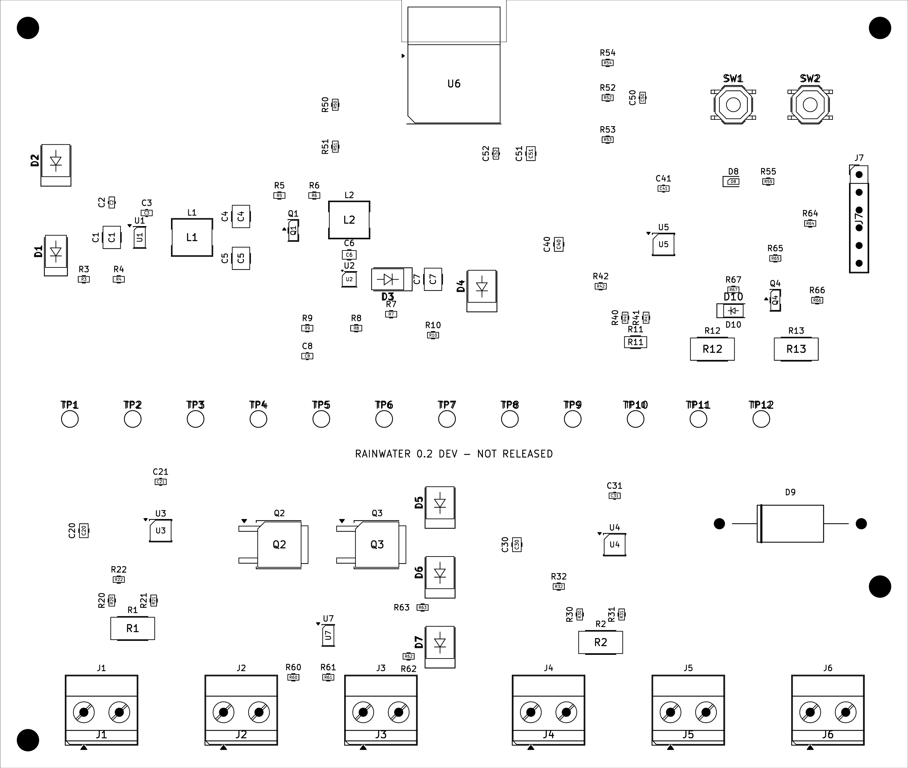
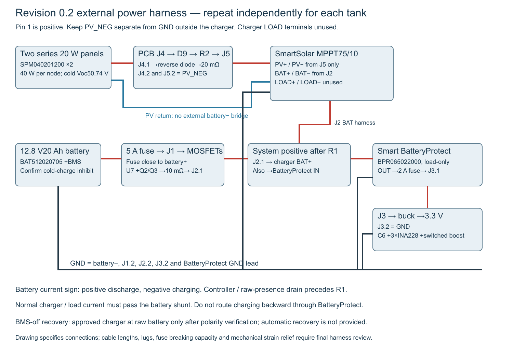

# Assembly and first power-up

Revision 0.2 is an engineering prototype. Read the schematic, connector table and manufacturing notes before assembly. Never use the superseded 0.1 ADS1115 wiring with this board.

1. Inspect the bare board against Gerbers: outline/notch, all four layers, PTH/NPTH, copper bridges and soldermask. Check resistance between battery input and ground and between 3.3 V and ground before fitting power.
2. Assemble small passives and ICs using the BOM and front assembly drawing. Verify U1 pin 1/feedback, U2 WSON pin 1/exposed pad, U3–U5 TSSOP orientation, MOSFET gate/source/drain and diode/LED polarities. Fit the module last if heat rework is likely. Use magnification to inspect every fine-pitch joint.
3. Fit 5.08 mm terminals and UART header. Identify pin 1 from the square pad and schematic; label the enclosure harness. Check continuity of battery shunt path, separate PV return and inactive boost gate before power.
4. With no battery, charger, panels or sensor attached, feed J3 from a current-limited bench supply, initially 12.8 V and 100 mA limit. Ramp cautiously; if the supply limits or a part heats, remove power. Check VIN after D1 and 3.3 V at TP2. A radio startup may require a higher limit after basic rails are verified; raise only after checking for faults.
5. Keep the loop off. Flash the owner-configured firmware through J7 with a 3.3 V UART; hold BOOT, pulse RESET, then release BOOT. Adapter TX connects J7 RXD, adapter RX connects J7 TXD, grounds common. Do not connect adapter VCC when the board supply is on. Select the actual serial port in ESPHome rather than guessing it.
6. Confirm all three monitor identities/addresses and status. Test disconnected inputs with a calibrated source, not a high-current battery. Verify current sign and scaling at several positive/negative battery currents and PV currents. Record zero/gain error and temperature.
7. Enable a measurement cycle with a current-limited loop simulator. Scope 3.3 V, switch node and boost output. Verify startup, overshoot, 5 s settling, nine samples, switch-off discharge and disabled/reset default-off. Test 4, 12, 20 and 24 mA plus open/short cases. A nominal 17.2 V reading alone is not loop-stability verification.
8. Qualify the full power harness on the bench. Battery fuse is external and close to battery positive. Use DC-rated insulated holders, suitable breaking capacity, correct crimp ferrules and strain relief. Keep the 40 W array limit; larger arrays invalidate current/thermal sizing. Route charger BAT and BatteryProtect IN from system positive after R1 using a rated distribution connector; never bypass the shunt.
9. Configure and prove the BMS cold-charge inhibit and BatteryProtect cutoff/recovery before installing the battery. Follow the charger’s battery-first, verify-voltage, load, then PV connection sequence; isolate PV before battery removal. Leave charger LOAD terminals unused. Separate PV_NEG from battery negative externally.
10. Fit the equipment to the backplate and proof-test shelf/straps. The CAD is a packaging study: actual cabinet boss and bought-part fixing patterns must be transferred from current drawings or measured parts. Use metal load-bearing battery supports, not an unqualified printed tray. Fit rated downward glands, dry sensor vent termination and hydrophobic pressure vent before enclosure tests.
11. Perform calibration, depth checks, Thread loss/recovery, OTA/serial recovery, thermal/condensation/ingress and seven-day winter-load tests. Use `docs/hardware-validation.md`; record observed values, instruments and corrective actions. No physical test is currently recorded as passed.

Before applying solar, test J1 normal polarity, reversed polarity, absent battery and fault indication with a current-limited isolated bench source. Confirm U7/Q2/Q3 block reverse connection and permit normal charge/discharge. GPIO19 fault plus GPIO20 raw presence must invalidate SOC/loop readings under every relevant case, including a live charger with no battery. Check D9 orientation and forward heat. Do not intentionally reverse a real battery or live array. A fully off BMS requires maker-approved direct raw-battery recovery after polarity verification; the board cannot wake it automatically.
