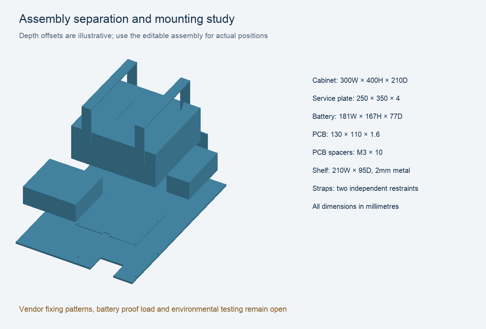

# Enclosure, mounting and service layout

`hardware/cad/freecad/TankMonitorAssembly.FCStd` is an editable FreeCAD 1.1.4 packaging study. The 130 × 110 × 1.6 mm PCB body is imported from the actual KiCad STEP export. The battery, charger, BatteryProtect and cabinet are explicitly labelled reference envelopes, not vendor mould CAD. `assembly-validation.json` records solid validity, eight intersection checks and independent STEP volume round trips. These are geometry checks, not load, ingress or fit tests.

The selected Fibox ARCA403021S / 8120087 is 400H × 300W × 210D mm, UV-rated polycarbonate. **The current manufacturer page specifies IP65**, despite some distributor IP66 descriptions; this project uses the primary-source IP65 rating. The assembled cabinet has no verified ingress rating until the glands, vent and mounting are tested. Its −40 to 80°C cabinet material rating does not authorize the battery or electronics to operate at those extremes. Shade the enclosure and measure worst-case internal temperature.

The proposed service plate is 250 × 350 × 4 mm aluminum, at (25,25,12) in the model. The manufacturer's included plate is 250 × 350 × 2 mm steel; do not confuse the custom plate with the supplied accessory. Transfer the actual cabinet mounting-boss pattern from a current vendor drawing or received part. The separate shelf is 210 mm wide, 95 mm deep, 2 mm metal, with a 40 mm rear flange and four M5 clearance holes. It supports a 181W × 167H × 77D mm battery envelope, retained by two independent 20 mm straps. Proof-load the shelf and restraints for the battery mass and installation forces; there is no validated load-bearing printed battery tray.

PCB coordinates start at the top left of its board. Mounting holes are (4,4), (126,4), (4,106), (126,84) mm, diameter 3.2 mm; M3 × 10 mm spacers connect to the service plate. The model maps board X to plate X+145 and board Y to 360−Y. Route cable bundles away from the module antenna and the battery terminals. Keep a service space above the battery and ensure replacement does not disturb the suspended probe.

`TankMonitorExploded.FCStd` and `TankMonitorExploded.step` show component separation; depth offsets are illustrative. `SolarPostMount.FCStd` provides a separate editable north-facing 45° rack study for two 440 × 350 × 25 mm panels and 920 mm angle rails. Its 114.3 mm reference post fits the Fibox PMK ARCA30 / 8120841 stated 100–300 mm diameter range. Support arms, clamp patterns, bolt selection, wind load, footing and corrosion design require current panel drawings and site information. The model is not a certified structural design. Do not drill the tank or panel frame to make the study fit.

Candidate seals: Hummel HSK-K M16 1.209.1600.50 (4–8 mm) for each single PV cable; M20 1.209.2000.50 (6–12 mm) for the probe cable; Bopla DAE M12 52041000 pressure-equalisation vent. Confirm actual cable outside diameters, UV formulation, thread seals, torque and cabinet wall thickness before purchase/drilling. Never clamp two separate round cables in a single ordinary gland. Use downward entries and drip loops. Locate the vent in a sheltered side/underside area per its instructions.

The sensor atmospheric tube terminates in a dry, breathable filter/desiccant junction. Do not pot, cap or load the tube. Its reference must track ambient pressure through the cabinet vent; prove that response under temperature and weather changes. Desiccant replacement is a maintenance item, not permanent condensation prevention.

The earlier editable guard model remains a fit concept: Ø50 mm outer, Ø42 mm bore, 150 mm length, slots and independent suspension holes. Verify the configured LH-10 dimensional drawing, diaphragm location, material water compatibility, sediment/bubble behavior and cleaning access before fabrication. The cage base is not the diaphragm datum. The owner confirms garden water and secondary fire use; confirm wetted materials for that service. No manufacturer service-life guarantee has been established for this installation; inspect and trend calibration rather than assigning an invented lifetime.

Sources: [Fibox cabinet and accessories](https://www.fibox.com/products/ARCA-IEC/ARCA-403021/8120087), [Hummel gland table](https://www.hummel.com/en/cable-glands/products/plastic-cable-glands/hsk-k/), [Bopla vent family](https://www.bopla.de/en/enclosure-technology/cable-glands-general-accessories/pressure-compensation-elements).

The revised metal service plate has a 50×38 mm antenna-side notch. Its intersection with the 50×38×60 mm antenna metal-exclusion reference is zero in the saved assembly; this is the eighth checked pair. Plastic cabinet geometry is allowed in the reference region, but actual nearby metal, cable placement and tank detuning require RF testing. All export checks reopen four FCStd documents, 38 STEP solids/assemblies and 35 closed STL meshes; geometry checks establish export integrity, not vendor fit or structural approval.
