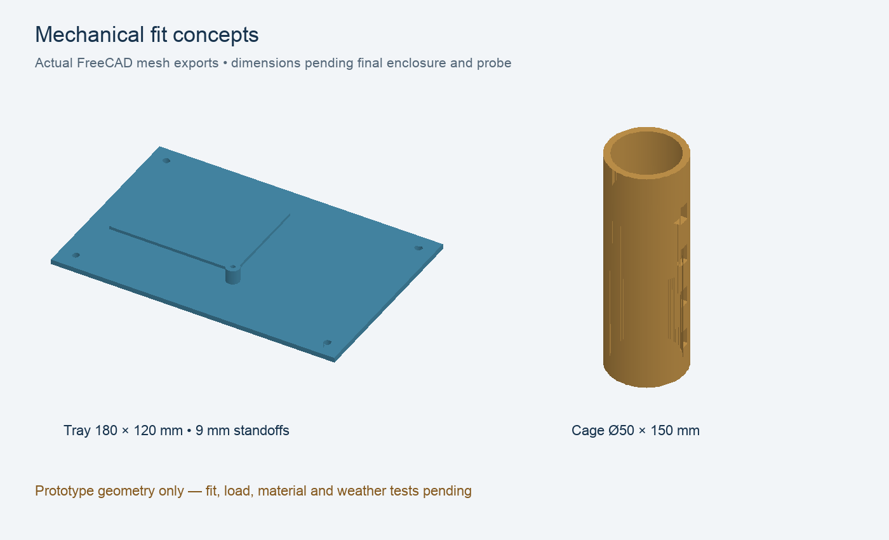

# Mechanical prototype

Generated with FreeCAD 1.1.4: hardware/cad/freecad/TankMonitorMechanical.FCStd. Parametric Part boxes, cylinders and Boolean cuts remain editable in the tree. The generator is alongside it. Geometry validation is in hardware/cad/validation.json. Tray: 180 x 120 x 3 mm, four 4.4 mm mounting holes at (10,10), (170,10), (10,110), (170,110). PCB envelope 80 x 60 x 1.6 mm is provisional, with four 9 mm high standoffs; it is not the final PCB.

Probe cage: 50 mm OD, 42 mm bore, 150 mm length with water slots and suspension holes. It is a fit concept, NOT verified against the selected probe dimensions. Test it for bubble retention, sediment blockage, cable abrasion, water compatibility and cleanability. Locate the actual diaphragm 50 mm above floor only if sediment survey permits; move higher when needed and recalibrate. Cage bottom clearance is not diaphragm clearance.

Choose a UV-rated purchased IP66 enclosure; printed tray/cage parts carry no IP claim. Keep battery below electronics, separate vented sensor cable termination from electronics and provide downward-facing rated glands, drip loops and a compatible hydrophobic pressure vent. Use a shaded installation and sun shield; enclosure air temperature must remain within component ratings. Never seal the atmospheric tube with potting, silicone or a tight plug. Provide replaceable desiccant/filter in a dry atmospheric reference termination.

Use a freestanding post or approved existing tank fitting; mounting clamp/solar frame requires a site-specific wind-load and corrosion review. No tank holes authorized. Use an independent rated suspension and strain relief, never the vent tube or electrical terminals. Avoid dissimilar metal contact and any unapproved water-contact material. If water is consumed, obtain applicable supplier water-contact certification.

Assembly order: qualify purchased enclosure, transfer verified internal mounting dimensions to tray, dry-fit battery/controller/PCB and glands, confirm service tool access and strain relief, then perform water-ingress and condensation tests. Electronics must unplug at the dry junction so the sensor remains suspended during service. Glands, final battery strap, solar bracket and enclosure assembly are outstanding, not represented by the concept tray model.

