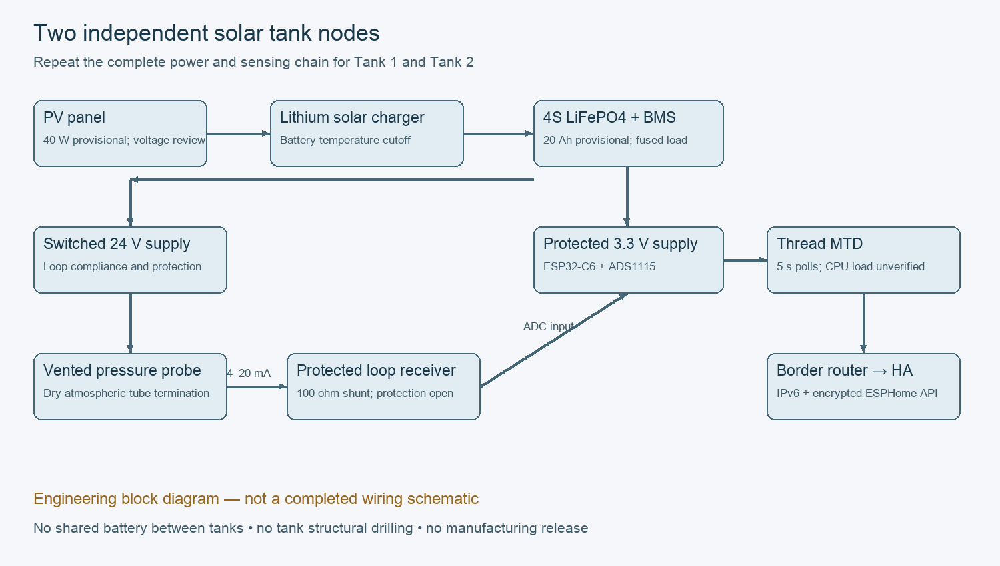

# Architecture and engineering boundaries

Each of two identical nodes has its own panel, controller, protected 4S LiFePO4 pack and fused load feed. Neither node supplies the other. Preferred radio is ESP32-C6 Thread MTD with 5 s polling; the design does not credit unmeasured processor sleep savings. Thread transports the ESPHome native API, not Matter.

PV -> lithium-compatible charger -> BMS battery -> battery fuse -> protected load disconnect -> 3.3 V regulator -> C6 and ADS1115. A separate switched regulated 24 V branch powers the two-wire pressure loop. Return current flows through a 100 ohm precision shunt to ground. A protected ADC interface measures shunt voltage. A battery shunt/fuel gauge is required for defensible battery percentage; voltage alone is insufficient for LiFePO4. Charging must come from measured battery current/controller telemetry, not PV voltage alone.

Tank geometry inputs: length, width, usable depth, diaphragm elevation, rated capacity and maximum operating level (floor datum). Usable depth must not exceed operating level. Usable volume means water above the configured unusable bottom layer. Also report total contained water separately when calibrated. Pressure cannot resolve water below the diaphragm; mark this blind region rather than inventing a depth. Manufacturer method uses verified total volume at a measured reference depth, never the unverified 10,000 L label.

Assumed 3.85 m operating level, 0.05 m diaphragm clearance and 4 m physical tank height are provisional. Obtain real dimensions, outlet elevation, maximum fill level, cable route, tank-water use, radio distances/shading and existing border-router details before installation. Do not drill the tank.

Measurement cycle: every 300 s, enable transmitter supply, wait a provisional 5 s, acquire nine readings, reject invalid current before robust filtering, publish measurements and diagnostic state, disable supply. Faults invalidate water quantities; never substitute the last good result as fresh. Settling must be confirmed by a power-cycle bench test.

